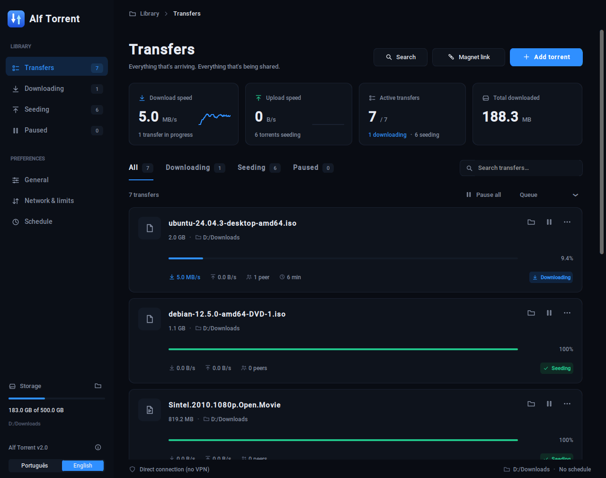
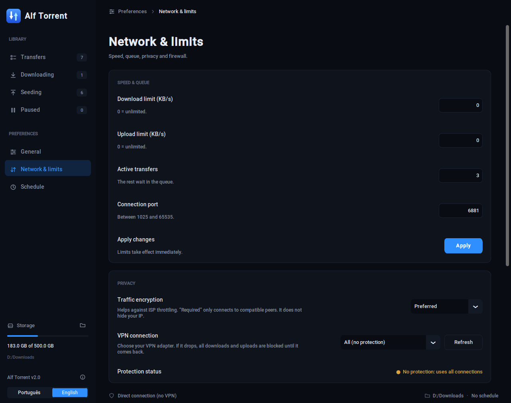

# Alf Torrent

**A modern, dark-themed BitTorrent client for Windows, built on [libtorrent](https://www.libtorrent.org/).**
Seed the library you already have without downloading it again, bind to your VPN with a kill switch, schedule downloads, and see exactly *why* uploads are (or aren't) happening.

   

[Português (Portugal)](README.pt-PT.md)




*Screenshots use sample data (freely licensed software and films).*

## Features

**Transfers**
- Add `.torrent` files or magnet links; filter (all / downloading / seeding / paused), search and sort the list.
- Queue with a configurable number of active downloads (default 3). Finished torrents keep seeding regardless of that limit.
- Pause/resume one or all, move torrents up or down the queue, set per-torrent speed limits, verify files, copy the magnet link.
- Global download/upload limits and a configurable listening port.
- Speeds shown are **file data only**: protocol overhead (requests, `have` messages…) is not counted, so a finished torrent shows `0 B/s` download.

**Seed what you already have**
- When you add a `.torrent`, the app looks for the files by name in your destination folder and in library folders you chose before. If they are complete, they are verified and seeded **without downloading anything**.
- If the files are somewhere else, it asks once and remembers the folder (also works for a whole batch).
- Fast-resume data is saved, so a large library is not re-hashed at every start.

**Network & privacy**
- **Traffic encryption** (disabled / preferred / required). It helps against ISP throttling; it does **not** hide your IP.
- **VPN binding with kill switch**: pick your VPN adapter and the app binds to it. If the adapter goes down, everything is blocked (downloads *and* uploads) and resumes automatically when it is back, even if its IP changes.
- UPnP/NAT-PMP is turned off while bound to a VPN adapter.

**Scheduling & automation**
- **Download window** (e.g. 01:00–08:00, can cross midnight). Outside it downloads wait; seeding continues.
- **Watched folder**: drop `.torrent` files in a folder and they are added and verified automatically (moved to `adicionados` / `erros` subfolders).
- Start with Windows, close to the system tray, completion notifications, `.torrent` / `magnet:` association and a single running instance.

**Diagnostics**
- **Test connection**: listening port, automatic router port mapping, DHT status, connected peers, incoming vs outgoing connections, and a CGNAT hint.
- **Torrent details**: per-torrent swarm info, trackers and a live peer list with speeds and who is requesting data from you.
- **Local upload test**: a local test peer downloads a few MB from one of your complete torrents to prove, end to end, that the app sends data and the screen shows it.

**Built-in search**
- Searches the [Internet Archive](https://archive.org/) (public-domain and freely licensed films, music, software and books) and adds the torrent in one click. No ads or pop-ups.

**Interface**
- Dark UI with a sidebar, live speed charts, per-transfer cards and settings pages.
- English and Portuguese (Portugal): follows the system language on first run and can be switched any time from the sidebar.
- *Discreet mode*: lower process priority, fewer simultaneous connections and no screen updates while the window is hidden. In a headless Linux test with 10 torrents the app used roughly 65 MB of RAM and 1–2 % CPU; your numbers will vary.

## Getting started

### Requirements
- Windows 10/11 (primary target)
- **Python 3.12, 64-bit** — `libtorrent` wheels are not published for every Python version (3.14, for example, has none yet)

### Run from source
```bat
py -3.12 -m venv .venv
.venv\Scripts\activate
pip install -r requirements.txt
python app.py
```

### Build the `.exe`
```bat
build.bat
```
The result is `dist\AlfTorrent.exe`. The GitHub Actions workflow in `.github/workflows/build.yml` also builds it on a Windows runner and uploads it as an artifact.

> The executable is **not code-signed**. Windows SmartScreen or your antivirus may warn about unsigned PyInstaller builds (false positive). You can inspect the source and build it yourself.

## Usage notes

**Getting upload to work.** Upload only happens when other peers can reach you. If the diagnostics say there are no incoming connections:
1. Create the Windows Firewall rule (*Network & limits → Windows Firewall*).
2. Forward **TCP and UDP port 6881** (or the port you configured) on your router to the PC's local IP, and reserve that IP for the PC. Use the **local** IP (e.g. `192.168.x.x`), not the public one.
3. If your ISP uses CGNAT (shared public IP), ports cannot be opened; the diagnostics will hint at it.
4. When bound to a VPN adapter, the port has to be opened at your VPN provider instead.

**VPN binding.** It binds the app's own sockets to the adapter, which works as an application-level kill switch. It does not control the DNS requests made by Windows, so trackers' host names may still be resolved through your normal DNS. You can verify with a torrent-detection test such as [ipleak.net](https://ipleak.net).

**Language.** Pick *Português* or *English* at the bottom of the sidebar (or in *General → Interface language*). It changes immediately.

## Data and settings

Stored in `%APPDATA%\AlfTorrent\`:

| Path | Content |
|---|---|
| `config.json` | Settings and the torrent list |
| `resume\` | Fast-resume data |
| `torrents\` | Copies of the added `.torrent` files |

## Limitations

- Windows-first. The system tray, start-with-Windows, file association and firewall rule are Windows features. From source the UI also runs on Linux (that is how the automated UI tests were run), but those features do not apply there.
- Encryption does not anonymise you, and the VPN binding is only as good as your VPN.
- Search is limited to the Internet Archive by design.

## Project layout

```
app.py              application (UI + engine glue)
i18n.py             translations (Portuguese source strings -> English catalog)
AlfTorrent.ico      icon (generated by make_icon.py)
make_icon.py        draws the icon with Pillow
build.bat           builds dist\AlfTorrent.exe with PyInstaller
requirements.txt    runtime dependencies
tests/              translation-catalog tests
docs/               screenshots
.github/workflows/  CI: tests + Windows build
```

## Contributing

- **Tests:** `python -m unittest discover -s tests -v` (no display or libtorrent needed). They check that every translated string exists in the catalog and that placeholders match.
- **Adding a language:** the source language is Portuguese. In `i18n.py`, add a dictionary to `CATALOGS` that maps each Portuguese string to its translation (copy the `EN` dictionary as a starting point), and add the language to `LANGUAGES`. Anything missing falls back to Portuguese.
- Keep user-facing text inside `tr("...")`; use named placeholders (`tr("{n} peers", n=3)`) and the `pl(n)` helper for plural suffixes.

## Third-party software

[libtorrent](https://www.libtorrent.org/) (BSD-3-Clause), [CustomTkinter](https://github.com/TomSchimansky/CustomTkinter) (MIT), [Pillow](https://python-pillow.org/) (HPND), [psutil](https://github.com/giampaolo/psutil) (BSD-3-Clause) and [pystray](https://github.com/moses-palmer/pystray) (LGPL-3.0). If you redistribute a compiled build, check the obligations of the LGPL for `pystray`; the source and `requirements.txt` here let anyone rebuild with a different version.

## Disclaimer

Alf Torrent is a general-purpose BitTorrent client. You are responsible for what you download and share: only use it with content you have the right to distribute.

## License

[MIT](LICENSE)
